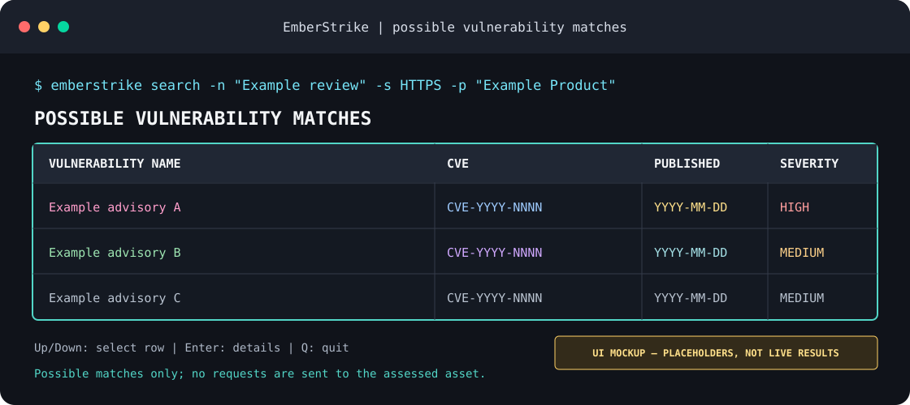
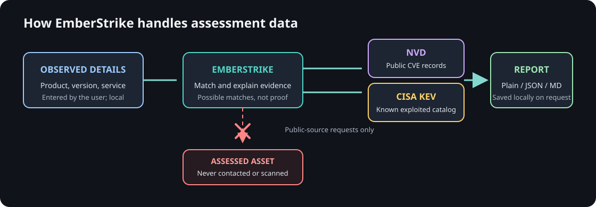

# EmberStrike

**Safe vulnerability research and reporting for authorized assessments.**


**Developer: [LordXapose](https://github.com/LordXapose)**

EmberStrike compares service details you already observed with public NVD and CISA Known Exploited Vulnerabilities (KEV) records. Every result is a **possible match**; a banner, product name, or version alone does not establish that a host is vulnerable.

The tool only contacts public vulnerability-data sources. It never connects to or scans an assessed asset and does not generate exploit payloads. Online searches send the vendor/product or service keyword to NVD; `show` sends the requested CVE ID to NVD, and the CISA KEV catalog is fetched. The full observation and saved report are not uploaded. **Use only within written authorization and scope. No credentials or secrets are needed.**

---

## Contents

- [Project overview](#project-overview)
- [Interface previews](#interface-previews)
- [Architecture and data flow](#architecture-and-data-flow)
- [Project structure](#project-structure)
- [Install](#install)
- [Quick start](#quick-start)
- [Tab completion](#tab-completion)
- [Command reference](#command-reference)
- [How to read matches](#how-to-read-matches)
- [Privacy and safety](#privacy-and-safety)
- [Roadmap](#roadmap)
- [Development and tests](#development-and-tests)

## Project overview

| Area | Details |
|---|---|
| Purpose | Research public vulnerability records against service and product observations |
| Public sources | NVD CVE records and CISA KEV catalog |
| Interface | Interactive terminal prompts, compact Rich tables, and selectable result rows |
| Output | Plain text, JSON, or Markdown; reports can be saved locally |
| Offline support | `--offline` uses matching local responses only and never accesses the network |
| Safety boundary | No target scanning, target requests, exploit payloads, or credentials |

### Main capabilities

- Search using an observed service or product, vendor, version, build, platform, modules, and confidence.
- Browse suggested service/product names and complete common values with Tab after shell setup.
- Review a compact table showing advisory name, CVE, publication date, and severity.
- Use Up/Down and Enter in an interactive terminal to select a result and view its details and source links.
- View a CVE directly with `emberstrike show CVE-ID`.
- Export plain, JSON, or Markdown reports; use `--include-low` to show Low and unscored severity results.
- Reuse public-source responses from a 24-hour local cache, inspect cache age, refresh entries, or clear the cache.
- See source outages and rate limits as notices rather than invented or success-shaped results.

### Technology stack

| Component | Technology | Use |
|---|---|---|
| Runtime | Python 3.10+ | CLI and research logic |
| Terminal tables | Rich | Colored tables and readable terminal output |
| Interactive selection | prompt-toolkit | Arrow-key navigation and keyboard controls |
| Shell completion | argcomplete | Service, product, and vendor suggestions |
| Version handling | packaging + EmberStrike version comparators | PEP 440 and conservative Debian/Ubuntu package comparisons |
| Unit tests | unittest | Input, matching, source parsing, and report behavior |
| Vulnerability data | NVD and CISA KEV | Public CVE and known-exploited records |

## Interface previews

The terminal image below is an **illustrative UI mockup**. Its placeholders are not CVE records or live research results.



## Architecture and data flow

EmberStrike never sends requests to the assessed system. In online mode, it sends the NVD search keyword or requested CVE ID to NVD and fetches the public CISA KEV catalog. It does not upload the full observation or generated report; reports are written to disk only when requested with `--output`.



| Component | Responsibility |
|---|---|
| CLI and prompts | Collect observations, validate inputs, and route commands |
| Matching | Compare supplied product/version evidence with public advisory data |
| NVD adapter | Retrieve and parse public CVE records |
| CISA KEV adapter | Identify CVEs listed in CISA's Known Exploited Vulnerabilities catalog |
| Report formatters | Render plain text, JSON, and Markdown |
| Rich table UI | Display compact results and interactive selection in a terminal |

## Project structure

```text
EmberStrike/
├── .gitignore
├── README.md
├── pyproject.toml               # Package metadata, dependencies, and emberstrike command
├── requirements.txt             # Runtime dependency list
├── docs/
│   └── images/                  # README diagrams and terminal UI preview
│       ├── emberstrike-data-flow.svg
│       └── emberstrike-terminal-preview.svg
├── tests/
│   ├── test_matching.py         # Product/version matching behavior
│   ├── test_reports_cli.py      # Inputs, CLI commands, tables, and report formats
│   └── test_sources.py          # Public-source parsing, pagination, and caching
└── vuln_research/
    ├── __init__.py
    ├── __main__.py              # python -m vuln_research entry point
    ├── banner.py                # Terminal banner
    ├── catalog.py               # Suggested products, services, and vendors
    ├── cli.py                   # CLI arguments, prompts, commands, and rendering
    ├── matching.py              # Advisory-to-observation matching
    ├── models.py                # Observation, advisory, and report data models
    ├── reports.py               # Plain, JSON, and Markdown serialization
    ├── research.py              # Source orchestration and severity filtering
    ├── selectable_table.py      # Rich tables and keyboard navigation
    ├── versioning.py            # Conservative PEP 440 and Debian version comparison
    ├── cache.py                 # Local public-source response cache and status
    └── sources/
        ├── __init__.py
        ├── base.py              # Public-source HTTP and error handling
        ├── cisa_kev.py          # CISA KEV integration
        └── nvd.py               # NVD CVE integration
```

The test suite uses Python's built-in `unittest` runner. The source adapters are separated from matching, reporting, and terminal rendering so integrations can be maintained independently.

## Install

Python 3.10 or later is required.

```bash
git clone https://github.com/LordXapose/EmberStrike.git
cd EmberStrike
python3 -m venv .venv
source .venv/bin/activate
python -m pip install -e .
```

Alternatively, install dependencies with `python -m pip install -r requirements.txt` and run `python -m vuln_research`.

## Quick start

Start an interactive session:

```bash
emberstrike
```

The interactive terminal opens with the custom EmberStrike ASCII banner you supplied and credits LordXapose. Structured JSON and Markdown output stays free of banner text.

Use dedicated commands for searching and viewing a CVE advisory:

```bash
emberstrike search \
  -n "Quarterly internal review" \
  -s HTTPS -p "Apache Tomcat" -v Apache \
  -V 9.0.80 -c High

emberstrike search -n "Include all severities" -p "Apache Tomcat" --include-low
emberstrike services
emberstrike show CVE-2023-42794
emberstrike cache
```

`-n` sets the assessment name, `-s` the observed service/protocol, `-p` the product, `-v` the vendor, `-V` the observed version, and `-c` the observation confidence. Long options remain available. `services` displays common service and product suggestions; the list is not exhaustive, and you can enter names not listed. `search` displays a compact table of vulnerability name, CVE ID, publication date, and severity. By default, Critical, High, and Medium severity records are shown; Low or unscored records are hidden. Add `--include-low` to include them. These are vulnerability advisory names, not exploit or proof-of-concept names. To inspect one CVE, use `emberstrike show CVE-ID`; its output is limited to a boxed details table and a source-name/link table. JSON output remains available for full structured records. EmberStrike does not provide exploit instructions, payloads, or proof-of-concept links.

In an interactive terminal, use the Up/Down arrow keys to move the highlighted row and press Enter to open that CVE's details and source links. Press Escape or Backspace to return to the result list, or Q to quit. Non-interactive and redirected output remains a static table. Pass `--non-interactive` to disable prompts and row selection.

Or provide observed details as flags. No target traffic is sent:

```bash
emberstrike \
  --assessment "Quarterly internal review" \
  --scope-notes "Written approval; staging environment only" \
  --asset app-01 \
  --port 8443 --protocol https \
  --service web-server --product "Apache Tomcat" \
  --vendor Apache --observed-version 9.0.80 --build-number "distro package 9.0.80-2" \
  --platform "Ubuntu 22.04" --modules "default configuration" \
  --identified-by "approved asset inventory" --confidence Medium \
  --format markdown --output report.md
```

Choose `--format plain`, `json`, or `markdown`. By default, EmberStrike shows Critical, High, and Medium severity records in a compact table; Low and unscored severities are hidden. Add `--include-low` to include them. `--limit 25` caps the number of matches. `--output FILE` saves that format locally and also prints the report. Use `--offline` to use only cache entries matching the same query; it never accesses the network. `--refresh-cache` forces a public-source update, with stale cached data used and clearly marked if refresh fails. These options cannot be combined. Use `--no-color` to disable color, or set `NO_COLOR` in the environment. `--non-interactive` disables prompts; it is useful for scripts. Run `emberstrike --help` for all input flags and examples.

The local response cache is fresh for 24 hours by default. Inspect or clear it with:

```bash
emberstrike cache
emberstrike cache clear
```

Cache files are stored under `${XDG_CACHE_HOME:-~/.cache}/emberstrike` unless `EMBERSTRIKE_CACHE_DIR` is set. Cached NVD search pages are specific to their query; an offline search can only reuse pages previously requested with the same search terms.

### Tab completion

EmberStrike uses `argcomplete` to complete common service, product, and vendor suggestions. After installing EmberStrike, enable completion for your shell:

**Bash** — add this line to `~/.bashrc`, then open a new shell:

```bash
eval "$(register-python-argcomplete emberstrike)"
```

**Zsh** — add this line to `~/.zshrc`, then open a new shell:

```zsh
eval "$(register-python-argcomplete --shell zsh emberstrike)"
```

Then type an option and press Tab, for example:

```bash
emberstrike search -s <TAB>
emberstrike search -p <TAB>
```

Completion suggests common names; custom service and product names remain accepted.

## Command reference

| Command | Purpose |
| --- | --- |
| `emberstrike` | Start an interactive assessment when run in a terminal. |
| `emberstrike [OPTIONS]` | Research supplied observation details without prompts when required values are provided. |
| `emberstrike search [OPTIONS]` | Run the same research flow with an explicit `search` command. |
| `emberstrike services` | List common service types and product suggestions. This list is not exhaustive. |
| `emberstrike show CVE-ID` | Retrieve public details for one CVE, including affected versions and remediation. |
| `emberstrike cache` | Show cached public-source responses and their ages. |
| `emberstrike cache clear` | Clear EmberStrike's local public-source cache. |
| `emberstrike COMMAND --help` | Show help and options for a command. |

### Search options

**Observation details**

| Option | Meaning |
| --- | --- |
| `-n`, `--assessment` | Assessment or engagement name (required). |
| `--scope-notes` | Brief note about written authorization and scope. |
| `-a`, `--asset` | Optional asset label or hostname. EmberStrike does not contact it. |
| `-P`, `--port` | Observed port, from 1 through 65535. |
| `--protocol` | Observed protocol, such as TCP or HTTPS. |
| `-s`, `--service` | Observed service or protocol; common values support Tab completion. |
| `-p`, `--product` | Product name; common values support Tab completion. |
| `-v`, `--vendor` | Product vendor; common values support Tab completion. |
| `-V`, `--observed-version` | Observed product version. |
| `--build-number` | Observed build or patch level. |
| `--platform` | Operating system or platform. |
| `--modules` | Modules or relevant configuration. |
| `--identified-by` | How the observation was collected. |
| `-c`, `--confidence` | Confidence in the observation: `High`, `Medium`, or `Low`. |

**Research and report controls**

| Option | Meaning |
| --- | --- |
| `--format` | Output as `plain`, `json`, or `markdown` (default: `plain`). |
| `--output FILE` | Save the report locally; the report is also printed. |
| `--offline` | Use matching cached responses only; never access the network. |
| `--refresh-cache` | Refresh matching cache entries from public sources; cannot be combined with `--offline`. |
| `--no-color` | Disable terminal color; `NO_COLOR` is also respected. |
| `--limit N` | Cap the number of possible matches (default: show all retrieved matches). |
| `--include-low` | Include Low and unscored severity results; hidden by default. |
| `--non-interactive` | Do not prompt; return a clear error if required inputs are missing. |

Run `emberstrike search --help` for the full search help. `show` accepts `--format`, `--output`, `--no-color`, `--offline`, and `--refresh-cache`; `services` accepts `--no-color`. `emberstrike cache [status|clear]` inspects or deletes EmberStrike's local cache.

## How to read matches

- **High / Medium / Low** describes how closely the supplied product/vendor/version details match the public record—not certainty about the host.
- Version ranges are compared only when source data provides a range the tool can interpret. Unknown or vendor-specific version formats remain uncertain.
- Build and patch details matter: distributions may backport fixes without changing an upstream version string. Review vendor guidance before drawing conclusions.
- CISA KEV status is shown only when the CVE appears in that catalog. Source outages, rate limits, and offline use are reported without fabricating records.
- Source status identifies cache hits, refreshed data, offline reuse, and stale-cache fallback with cache ages.
- Safe verification means checking an approved inventory or vendor-supported, non-invasive method. This tool provides no exploit steps.

## Privacy and safety

- Use EmberStrike only for assessments covered by your written authorization and scope.
- Enter only service details that you are authorized to assess; never enter credentials or secrets.
- The tool makes no connection to an assessed hostname or IP address.
- Online `search` sends the vendor/product or service keyword to NVD. `show` sends the requested CVE ID to NVD; both commands fetch the CISA KEV catalog. `--offline` reads matching cache files only and never makes public-source requests.
- Other observation fields and generated reports are not uploaded; reports are stored locally only when you request `--output`.
- Cache files contain public-source responses, are stored locally with owner-only permissions where supported, and can be removed with `emberstrike cache clear`.
- Results are possible matches, not proof that a system is vulnerable. Confirm with authoritative inventory and vendor guidance.
- No exploit payloads, target-scanning features, or instructions for gaining access are provided.

## Roadmap

Items are labeled as implemented or planned; planned work is not currently available. The order prioritizes match reliability before adding more data and workflows.

### 1. Match accuracy

- Implemented: exact product matching with a small explicit alias set, escaped-colon CPE parsing, and NVD pagination.
- Implemented: PEP 440 exact/range comparison, Debian/Ubuntu package ordering when indicated by the platform or version string, and normalized duplicate affected-entry removal.
- Implemented: inclusive/exclusive boundaries and conservative handling of unparseable or RPM-specific versions, covered by regression tests.
- Planned: expand version support only for additional ecosystems with reliable source and platform evidence; do not infer package equivalence.
- Distinguish product match, version match, and host verification, and explain what evidence supports each confidence level.
- Planned: add broader tests for vendor forks, distro backports, missing versions, and conflicting evidence.

**Milestone:** matches show their supporting evidence and uncertainty, while unsupported matches are filtered or clearly qualified.

### 2. Source reliability and completeness

- Implemented: 24-hour local response cache, offline reuse, forced refresh, cache status/clear commands, age indicators, and clearly reported stale-cache fallback.
- Planned: use conditional HTTP requests where supported to reduce downloads when cached entries expire.
- Planned: distinguish all source failures consistently and add bounded retries that respect public API guidance.

**Milestone:** a source failure is never presented as evidence that no vulnerabilities exist; cached data can support repeat or offline research.

### 3. Trusted-source evidence

- Expand modular adapters for primary vendor advisories and trusted public catalogs.
- Display available CVSS score/vector, CWE, affected configurations, remediation dates, and fixed versions.
- Attribute each important fact to its source; label unavailable information rather than filling gaps.
- Treat vendor “not affected” and fixed-version statements as evidence to assess, not host-level proof.

**Milestone:** users can trace advisory, version, severity, and exploitation claims to the source that supplied them.

### 4. CLI and reporting workflow

- The command guide and command-specific help are implemented; continue refining interactive prompts, validation, and input review before lookup.
- Add table sorting/filtering and concise versus detailed display modes.
- Version the JSON report schema and add report timestamps and assessment metadata.
- Keep the custom banner readable in narrow terminals and separate from machine-readable output.

**Milestone:** a new user can run a search, interpret its evidence, and save a report without needing prior CVE expertise.

### 5. Local inventory and assessment workflows

- Support local SBOM or package inventory imports, such as CycloneDX and SPDX, for comparison with public advisories.
- Add optional local case files to save observations and reports without uploading assessment data.
- Compare reports over time to identify newly published or changed advisories.
- Add redacted exports and configurable local retention.

**Milestone:** users can repeat and compare an assessment locally without EmberStrike connecting to assessed assets or transmitting inventory details.

### 6. Packaging and release quality

- Add CI for tests, formatting, type checks, and dependency/security checks.
- Test supported Python versions and Linux, macOS, and Windows terminal behavior.
- Publish versioned releases and document sources, limitations, privacy, and responsible use.
- Include synthetic sample reports clearly labeled as examples.

**Milestone:** fresh installs and documented commands work in CI, and published releases correspond to tested source.

### Recommended implementation order

1. Match accuracy and NVD pagination.
2. Source provenance, caching, and better outage handling.
3. Vendor-source coverage and report improvements.
4. Local inventory/SBOM workflows and release automation.

EmberStrike will remain a research and reporting assistant: no target scanning, exploit payloads, proof-of-concept execution, or instructions for gaining access.

## Development and tests

Run the unit tests from the project root:

```bash
python -m unittest discover -s tests -v
```

The tests cover input handling, product/version matching, public-source parsing, CLI rendering, and report formats. They do not require sending requests to an assessed asset.
